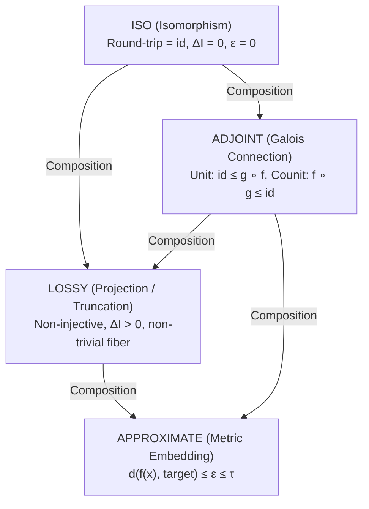

# AMDE Core Navigator: Type System Specification

**Standard Reference**: `PRD-26` (amde-core-navigator-typed-transformation-graph-claim-registry)  
**Ticket**: `MIN-79`  
**Acceptance Benchmark**: `RP-002`  
**Status**: Formal Reference Specification & Verified Rust Implementation  

---

## 1. Navigator Object Formalization: $(X, R, \Sigma, \tau, I)$

In the AMDE (Arithmetic Markov Dynamical Equations) framework, a mathematical or computational frame is represented as a formal 5-tuple:

$$\mathcal{O} = (X, R, \Sigma, \tau, I)$$

Where:

### 1.1 Carrier State Space $X$
The underlying domain or carrier representation. The carrier set represents states, vectors, or structures:
- $\mathbb{N}^+$: Positive integers in multiplicative arithmetic.
- $\bigoplus_{p \in \mathbb{P}} \mathbb{N}$: Finitely-supported prime valuation vectors $(v_p)_{p \in \mathbb{P}}$.
- $\mathbb{N}^K$: Bounded $K$-dimensional truncation vectors over leading prime channels $\{p_1, \dots, p_K\}$.
- $\mathbb{R}$ / $\mathbb{C}$: Continuous analytic coordinate arguments for dynamical functional evaluation.
- $\mathcal{I}(\mathbb{R})$: Certified floating intervals $[x - \epsilon, x + \epsilon]$.

### 1.2 Relational & Algebraic Structure $R$
The relations, internal operations, and axioms governing elements of $X$:
- $\text{MultiplicativeMonoid}$: Associative product with neutral element $1$, divisibility preorder $a \mid b \iff \exists c, b = a \cdot c$.
- $\text{FreeCommutativeMonoid}$: Free additive monoid over prime generators with componentwise lattice operations $\min$ (gcd) and $\max$ (lcm).
- $\text{FiniteComponentwiseLattice}$: Bounded product lattice with coordinatewise partial order $\mathbf{u} \le \mathbf{v}$.
- $\text{OrderedField}$: Linearly ordered field with analytic reflection symmetry.

### 1.3 Transition Signature $\Sigma$
The set of admissible transitions, operators, and dynamic generators:
- Discrete prime generators: multiplication by prime powers $p^k$, divisibility checks, gcd, lcm.
- Projection operators: coordinate truncation $\pi_K$, canonical embedding $\iota_K$.
- Analytic operators: functional evaluation $\xi(s)$, reflection $s \mapsto 1 - s$, directional differentiation.

### 1.4 Topology & Metric Structure $\tau$
The metric or tolerance structure defining neighborhoods, convergence, and error bounds:
- **Discrete Exact Metric**: $d(a, b) = 0 \iff a = b$, tolerance $\tau = 0.0$.
- **Metric Tolerance**: $d(x, y) \le \epsilon$ for certified numerical bounds.
- **Truncation Cutoff**: Depth horizon $K$ defining information boundaries.

### 1.5 Information Functional $I$
The conserved invariant, height, or valuation entropy measuring information content:
- For integers: logarithmic height $I(n) = \ln(n)$.
- For prime valuation profiles: logarithmic valuation weight $I(\mathbf{v}) = \sum_{p} v_p \ln(p)$.
- For truncated vectors: prefix information $I_K(\mathbf{w}) = \sum_{i=1}^K w_i \ln(p_i)$.
- For numerical results: certified precision bits $I(\text{res}) = -\ln(\max(\epsilon, 10^{-16}))$.

---

## 2. Typed Transformation Graph: Morphism Classes

Morphisms between Navigator objects $T: \mathcal{O}_A \to \mathcal{O}_B$ are strictly partitioned into four canonical kinds:



### 2.1 `ISO` (Isomorphism)
- **Signature**: $f: X_A \to X_B$, $g: X_B \to X_A$.
- **Axioms**:
  1. Forward-backward round-trip: $\forall a \in X_A, g(f(a)) = a$.
  2. Backward-forward round-trip: $\forall b \in X_B, f(g(b)) = b$.
  3. Information preservation: $I_B(f(a)) = I_A(a) \implies \Delta I = 0$.
  4. Exact metric: $\epsilon = 0$.
- **Benchmark**: Prime Factorization (RP-002): $\mathbb{N}^+ \leftrightarrow \bigoplus_{p} \mathbb{N}$.

### 2.2 `ADJOINT` (Adjunction / Galois Connection)
- **Signature**: Left adjoint $L: X_A \to X_B$, Right adjoint $R: X_B \to X_A$.
- **Axioms**:
  1. Adjunction equivalence: $\forall a \in X_A, b \in X_B: L(a) \le_B b \iff a \le_A R(b)$.
  2. Unit condition: $a \le_A R(L(a))$ (identity for sections: $R(L(a)) = a$).
  3. Counit condition: $L(R(b)) \le_B b$.
- **Benchmark**: Valuation Embedding & Retraction: $\mathbb{N}^K \leftrightarrows \bigoplus_{p} \mathbb{N}$.

### 2.3 `LOSSY` (Lossy Projection)
- **Signature**: $\pi: X_A \to X_B$.
- **Axioms**:
  1. Non-injectivity: $\exists a_1 \ne a_2 \in X_A$ such that $\pi(a_1) = \pi(a_2)$.
  2. Non-negative information loss: $\Delta I(a) = I_A(a) - I_B(\pi(a)) \ge 0$.
  3. Non-trivial fiber: $|\pi^{-1}(b)| > 1$ for non-minimal targets.
- **Benchmark**: Prime Horizon Truncation (RP-002): $\bigoplus_p \mathbb{N} \to \mathbb{N}^K$.

### 2.4 `APPROXIMATE` (Metric Approximation)
- **Signature**: $f: X_A \to X_B$.
- **Axioms**:
  1. Metric error bound: $d_{X_B}(f(a), \text{target}(a)) \le \epsilon$.
  2. Tolerance compliance: $\epsilon \le \tau_B$.
  3. Reflection / Invariant tracking: verified up to certified bound $\epsilon$.
- **Benchmark**: Numerical $\xi(s)$ evaluation (RP-002) with certified remainder bound.

---

## 3. Transformation Category Algebra

The transformation kinds form a closed algebraic semi-lattice under composition $T_2 \circ T_1$:

| $T_2 \backslash T_1$ | `ISO` | `ADJOINT` | `LOSSY` | `APPROXIMATE` |
|:---|:---:|:---:|:---:|:---:|
| **`ISO`** | `ISO` | `ADJOINT` | `LOSSY` | `APPROXIMATE` |
| **`ADJOINT`** | `ADJOINT` | `ADJOINT` | `LOSSY` | `APPROXIMATE` |
| **`LOSSY`** | `LOSSY` | `LOSSY` | `LOSSY` | `APPROXIMATE` |
| **`APPROXIMATE`** | `APPROXIMATE` | `APPROXIMATE` | `APPROXIMATE` | `APPROXIMATE` |

**Algebraic Properties**:
- Associativity: $(T_3 \circ T_2) \circ T_1 = T_3 \circ (T_2 \circ T_1)$.
- Identity element: `ISO` acts as the two-sided identity.
- Absorbing element: `APPROXIMATE` acts as the annihilator / top absorbing element.

---

## 4. Claim Registry Contract

Every transformation step records an immutable `ClaimReceipt`:
```json
{
  "claim_id": "CLAIM-MIN79-0001-48f94e0b",
  "transformation": "PrimeFactorizationIso",
  "kind": "ISO",
  "source": "Natural Numbers Monoid (N+, *)",
  "target": "Prime Valuation Direct Sum Monoid (Primes ->0 N)",
  "input": "n=60",
  "output": "2^2 * 3 * 5",
  "verified": true,
  "roundtrip_discrepancy": 0.0,
  "information_loss": 0.000000,
  "metric_error": 0.00000000,
  "sha256": "48f94e0b...",
  "notes": "RP-002 Prime Factorization verified: exact bijective roundtrip, Delta I = 0"
}
```
All claims are cryptographically hashed using standard SHA-256 for deterministic auditing.
