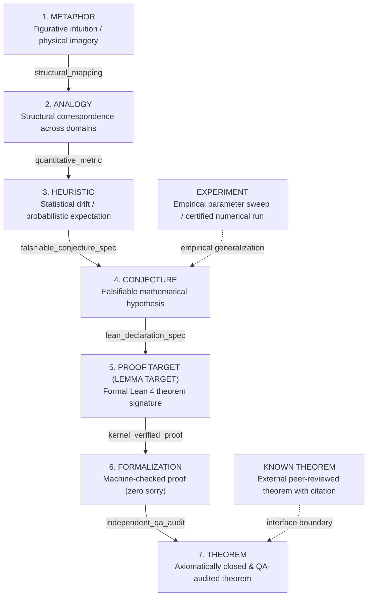

# RP-002 Claim Registry Seed & Epistemic Typing Specification

**Ticket**: `MIN-83`  
**Parent PRD**: [PRD-26](https://linear.app/mindrock/issue/PRD-26/amde-core-navigator-typed-transformation-graph-claim-registry)  
**Status**: Formal Reference Specification & Verified Rust Implementation  
**Builder**: agy@wolfram  
**Reviewer**: Muse  
**Date**: 2026-11-02  

---

## 1. Executive Summary & Epistemic Foundations

In accordance with **PRD-26 (AMDE Core Navigator: Typed Transformation Graph & Claim Registry)** and **MIN-83**, this specification formalizes the foundational claim registry and seeds it with the eight canonical mathematical claims from **RP-002**.

In mathematical discovery and physical computing architectures (such as AMDE), ideas traverse multiple stages of rigor—from initial intuitive metaphors to machine-checked kernel theorems. A fatal hazard in autonomous and agentic mathematical systems is **epistemic corruption**: the silent promotion of an analogy, heuristic, or conjecture to the status of a proven theorem or verified lemma without meeting rigorous verification barriers.

To eliminate this vulnerability, the AMDE Claim Registry implements:
1. A **typed epistemic lattice** classifying all statements into nine rigorous categories.
2. A **pre-seeded canonical registry** of the eight core RP-002 claims.
3. An **anti-silent-promotion state machine** that strictly rejects non-stepwise transitions and demands cryptographic evidence tokens before elevation.
4. An **immutable cryptographic audit trail** (`PromotionEvent`) where every transition is signed via SHA-256 and recorded permanently.

---

## 2. Epistemic Taxonomy (PRD-26 Classification)

Every mathematical statement, hypothesis, or transformation receipt in AMDE is assigned exactly one epistemic type from the following taxonomy:

### Definitions:
1. **`METAPHOR` (Rigor Rank: 1)**: Pure figurative intuition without formal operational mapping (e.g. "Collatz trajectories behave like viscous fluid flow").
2. **`ANALOGY` (Rigor Rank: 2)**: Structural and categorical correspondence between distinct state spaces $\mathcal{O}_A$ and $\mathcal{O}_B$ with identified parallel operators.
3. **`HEURISTIC` (Rigor Rank: 3)**: Statistical or asymptotic approximation model providing expected drift rates without universal error bounds.
4. **`CONJECTURE` (Rigor Rank: 4)**: A precise, falsifiable mathematical proposition with explicit domain bounds, having survived extensive numerical counterexample searches ($N \ge 10^6$).
5. **`PROOF_TARGET` / `LEMMA_TARGET` (Rigor Rank: 5)**: Machine-readable theorem signature and decomposition in an interactive proof assistant (Lean 4) with explicit dependencies.
6. **`FORMALIZATION` (Rigor Rank: 6)**: Machine-verified proof term verified in a proof assistant kernel without unproven axioms, `sorry`, or `admit`.
7. **`THEOREM` (Rigor Rank: 7)**: Fully audited theorem within the AMDE foundation, verified by independent cross-agent QA and closed under standard foundations (`propext`, `Classical.choice`, `Quot.sound`).
8. **`KNOWN_THEOREM` (Rigor Rank: 7)**: External mathematical theorem established in published, peer-reviewed literature with precise bibliographic attribution.
9. **`EXPERIMENT` (Rigor Rank: 3)**: Certified numerical computation (e.g. Arb ball arithmetic) or parametric search on a bounded domain.

---

## 3. Seed Registry: RP-002 Mathematical Claims

The registry is initialized with the eight canonical claims of RP-002:

| Claim ID | Epistemic Type | Title | Morphism Kind | Verified | Invariant / Formula | Lean 4 Symbol / Citation |
|:---|:---:|:---|:---:|:---:|:---|:---|
| `CLAIM-RP002-001` | **THEOREM** | Prime Factorization as Reversible Compiler | `ISO` | ✅ YES | $n = \prod_{p} p^{v_p(n)}$; $\mathbb{N}^+ \simeq^* \bigoplus_{p} \mathbb{N}$, $\Delta I = 0$ | `Amde.PrimeValuation.primeValuationMulEquiv` |
| `CLAIM-RP002-002` | **THEOREM** | Golden Widths Asymptotic Convergence ($G_n \to 1/2$) | `LOSSY` | ✅ YES | $G_n = [1/2 - \phi^{n+3}/2, 1/2 + \phi^{n+3}/2]$; $\lim_{n \to \infty} G_n = \{1/2\}$ | `Amde.intersection_goldenSets` |
| `CLAIM-RP002-003` | **CONJECTURE** | Golden Scaling Dynamically Privileged | `APPROXIMATE` | ⏳ PENDING | $[1 - \phi, \phi] = [0.382, 0.618]$ of width $\phi^3 \approx 0.236$ around $1/2$ is invariant attractor | Renormalization dynamical model |
| `CLAIM-RP002-004` | **CONJECTURE** | Collatz Golden Contraction | `LOSSY` | ⏳ PENDING | On 2-adic valuation slices, accelerated Syracuse map has $\lambda_{\mathrm{eff}} \le \phi \approx 0.618$ | 2-adic valuation contraction hypothesis |
| `CLAIM-RP002-005` | **KNOWN THEOREM** | Li Positivity Equivalence with RH | `APPROXIMATE` | ✅ YES | $\text{RH} \iff \forall n \ge 1, \lambda_n = \sum_{\rho} [1 - (1 - 1/\rho)^n] \ge 0$ | Xian-Jin Li (1997), Bombieri & Lagarias (1999) |
| `CLAIM-RP002-006` | **HEURISTIC** | Syracuse Heuristic Log-Drift $3/4$ | `LOSSY` | ⏳ PENDING | $\mathbb{E}[\log_2(S(n)/n)] \approx \log_2(3) - 2 \approx -0.415 \approx \ln(3/4)$ | J. Lagarias (1985) |
| `CLAIM-RP002-007` | **ANALOGY** | Perelman Monotonicity Transfer | `ADJOINT` | ⏳ PENDING | Perelman $\mathcal{W}$-entropy monotonicity $\frac{d\mathcal{W}}{dt} \ge 0 \longleftrightarrow \Delta I \ge 0$ | G. Perelman (2002), arXiv:math/0211159 |
| `CLAIM-RP002-008` | **PROOF TARGET** | Collatz Descent Below Start | `LOSSY` | ⏳ PENDING | $\forall n \in \mathbb{N}_{\text{odd}}, n > 1 \implies \exists k \ge 1: S^k(n) < n$ | `Amde.DescentCertificate` |

---

## 4. Promotion Criteria & Transition Gates

Promotion along the epistemic ladder is governed by strict, falsifiable gates. Each step requires a specific **evidence token**:

### Gate 1: `METAPHOR` $\to$ `ANALOGY`
- **Required Evidence Kind**: `structural_mapping`
- **Description**: Explicit domain mapping between source space $\mathcal{O}_A$ and target space $\mathcal{O}_B$ with operational signature alignment.
- **Falsification Barrier**: State space mismatch or undefined operations invalidates the analogy.
- **Verification Gate**: Navigator Object signature alignment check.

### Gate 2: `ANALOGY` $\to$ `HEURISTIC`
- **Required Evidence Kind**: `quantitative_metric`
- **Description**: Quantitative formulation with measurable metrics, empirical distribution, or drift bounds.
- **Falsification Barrier**: Empirical observations diverging from predicted drift metric.
- **Verification Gate**: Monte Carlo or deterministic drift evaluation over sample space.

### Gate 3: `HEURISTIC` $\to$ `CONJECTURE`
- **Required Evidence Kind**: `falsifiable_conjecture_spec`
- **Description**: Rigorous mathematical formulation with universal/existential quantification and domain bounds.
- **Falsification Barrier**: Any counterexample found during numerical exploration falsifies the conjecture.
- **Verification Gate**: Exhaustive counterexample search ($N \ge 10^6$) with zero anomalies.

### Gate 4: `CONJECTURE` $\to$ `PROOF_TARGET`
- **Required Evidence Kind**: `lean_declaration_spec`
- **Description**: Machine-readable theorem signature in Lean 4 with explicit dependencies and proof strategy.
- **Falsification Barrier**: Type error, circular dependency, or unprovable lemma target.
- **Verification Gate**: Lean 4 environment typecheck and dependency graph verification.

### Gate 5: `PROOF_TARGET` $\to$ `FORMALIZATION`
- **Required Evidence Kind**: `kernel_verified_proof`
- **Description**: Complete machine-checked proof in Lean 4 kernel with zero `sorry` or `admit`.
- **Falsification Barrier**: Kernel rejection or unproven `sorry`/`admit` in proof term.
- **Verification Gate**: `lake build` and `#print axioms` confirming standard axioms only (`propext`, `Classical.choice`, `Quot.sound`).

### Gate 6: `FORMALIZATION` $\to$ `THEOREM`
- **Required Evidence Kind**: `independent_qa_audit`
- **Description**: Independent cross-agent audit receipt (PASS) confirming scope, zero shortcuts, and axiomatic closure.
- **Falsification Barrier**: Hidden assumptions, unstated premises, or non-standard foundation axioms.
- **Verification Gate**: Two-agent cross-peer verification receipt (`agy` $\leftrightarrow$ `codex` $\leftrightarrow$ `gemini`) + Principal release gate.

---

## 5. Anti-Silent-Promotion Rules (Запрет тихой промоции метафоры в лемму)

To prevent unearned claims from polluting the research graph:

1. **Leap Prohibition**:
   Direct transitions that skip intermediate rungs (e.g., `METAPHOR` $\to$ `PROOF_TARGET`, `ANALOGY` $\to$ `THEOREM`, `HEURISTIC` $\to$ `FORMALIZATION`) are rejected at the type-system level with `PromotionError::SilentPromotionDisallowed`.

2. **Evidence Authentication**:
   Every promotion call must supply the exact required evidence kind. Supplying placeholder text or mismatched evidence triggers `PromotionError::MissingRequiredEvidence`.

3. **Downgrade Guard**:
   Demoting a proven `THEOREM` or `FORMALIZATION` via the promotion API is rejected with `PromotionError::DowngradeNotSupported`.

4. **Cryptographic Trail**:
   Each successful promotion creates an immutable `PromotionEvent` containing:
   $$\text{Hash} = \text{SHA256}(\text{from} \parallel \text{to} \parallel \text{kind} \parallel \text{ref} \parallel \text{verifier} \parallel \text{timestamp})$$
   The claim's master SHA-256 hash is recomputed to bind its entire promotion lineage.

---

## 6. Verification and Export Formats

The reference implementation supports canonical serializations:
- **Markdown Table**: `ClaimRegistry::export_seed_markdown_table()` outputs the acceptance matrix formatted for Linear and reports.
- **JSON Manifest**: `ClaimRegistry::export_seed_json()` exports the machine-readable schema with individual cryptographic hashes and verification status.
- **Integrity Check**: `ClaimRegistry::verify_seed_integrity()` recomputes all SHA-256 hashes against canonical payloads and asserts $100\%$ tamper resistance.
